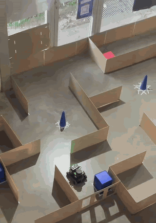
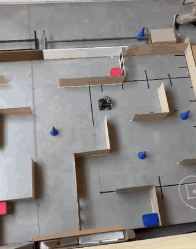
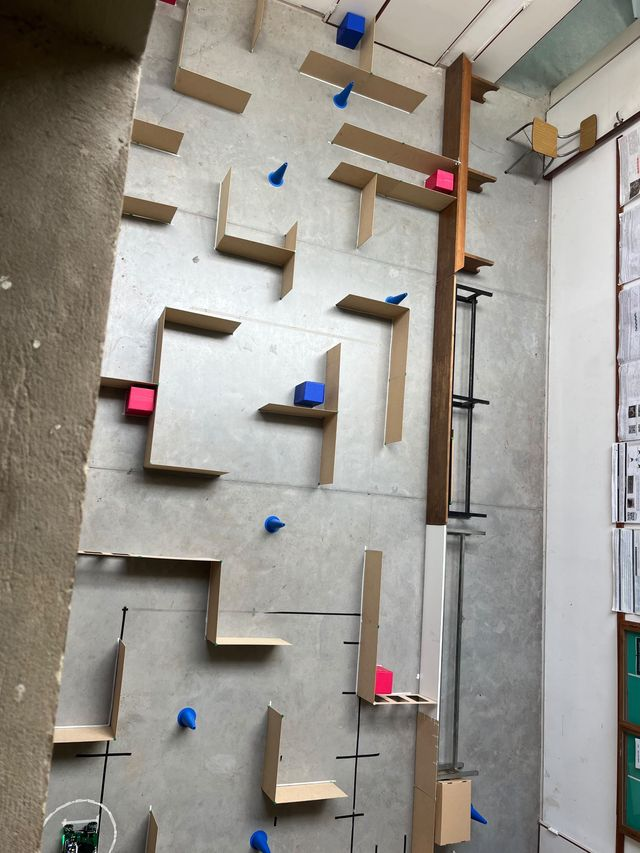
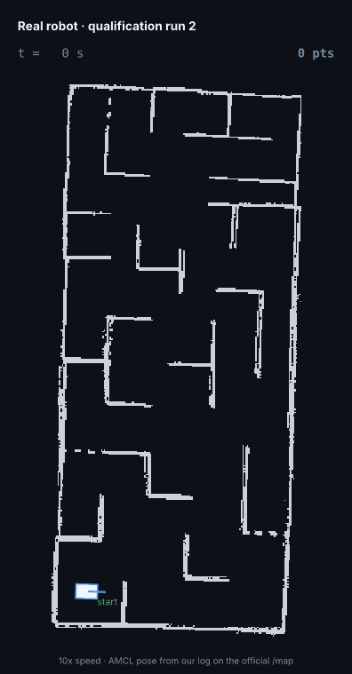
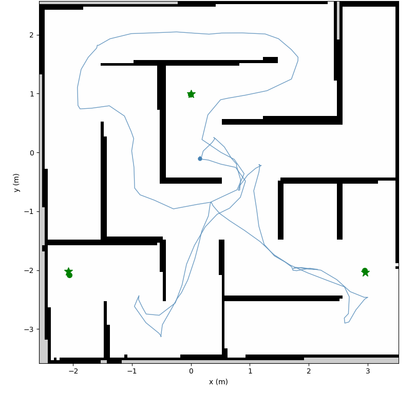
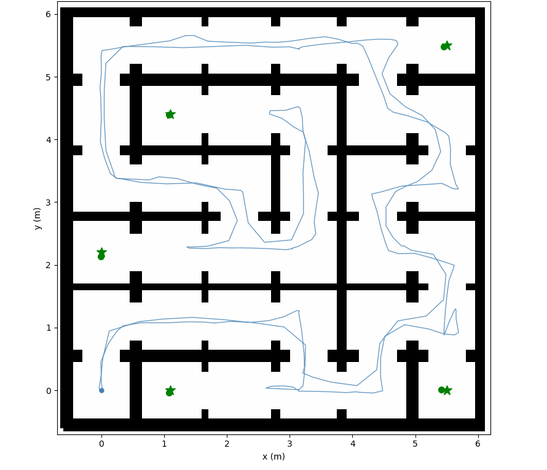
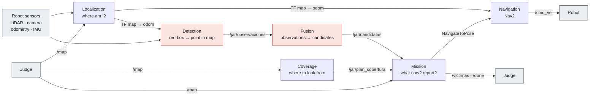
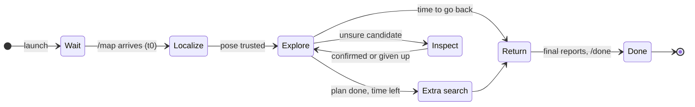

<div align="center">

# TARS: an autonomous search-and-rescue robot

**ROS 2 software that drives a robot through a maze it has never seen, finds the red "victim" boxes
with a camera and a LiDAR, reports where they are and drives back to the start.
Fully autonomous: 10 minutes, no remote control, no second try.**

Team TARS · [JAR Challenge 2026](https://airclub-udesa.github.io/jar_site/) (Jornada Argentina de Robótica, Rosario) ·
organized by [AIR Club UdeSA](https://github.com/AIRclub-UdeSA)


**🥉 3rd place in the final · 3rd of 12 teams in qualification · most victims found in the final**


<br><sub>The real robot exploring the final's maze (first run) · 4× speed</sub>

</div>

---

## Contents

- [The challenge](#the-challenge)
- [Demos](#demos)
- [Results](#results)
- [How it works](#how-it-works)
- [Engineering highlights](#engineering-highlights)
- [Repository layout](#repository-layout)
- [Run it](#run-it)
- [Team](#team)

## The challenge

A Yahboom ROSMASTER X3 (mecanum wheels, ROS 2 Humble) is placed by hand near the start of a maze. When the judge publishes the maze map on `/map`, a
10-minute clock starts. From then on the robot is on its own:

1. **Localize** on a map it receives only at the start, from a hand placement that is never exact.
2. **Explore** without touching walls, boxes or obstacles that are not in the map.
3. **Find the victims** (red boxes) and ignore the distractors (boxes of other colors).
4. **Report** each victim's center on `/victimas`. There are only N reports: a wrong one is lost.
5. **Return** to the start and publish `/done`.

| Event | Points |
| --- | --- |
| Report within 0.25 m / 0.50 m of a victim's center | +100 / +50 |
| All victims scored before 5 minutes | +200 |
| `/done` within 0.25 m of the start | +100 |
| Each collision | −50 |
| Tipping over | the run scores 0 |

Two details make it hard: the official position is the box's **center**, but the robot only sees
one face, 0.125 m closer (half of the 100-point margin). And the competition maze, victims and
obstacles are new: hard-coded coordinates or routes are forbidden, so everything must come from
`/map` and the sensors during the run. Full rules: [reglamento](https://airclub-udesa.github.io/jar_site/reglamento/).

**This was our first robotics project.** None of the five of us had used ROS 2 before. We went from
the first commit to the competition in three weeks (Oct 14 → Nov 5, 2026): 200+ commits and 69 pull
requests.

## Demos

### The real robot

<table>
<tr>
<td width="50%" align="center"></td>
<td width="50%" align="center"></td>
</tr>
<tr>
<td align="center">Exploring the qualification maze · 3× speed</td>
<td align="center">The qualification arena from above: red victims, blue distractors, and cones that are not in <code>/map</code></td>
</tr>
</table>

<!-- FULL_RUN_VIDEO: paste below, on its own line, the github.com/user-attachments URL of final_run_4x.mp4,
     with a line above it such as: **The final's first run, complete, at 4× speed:** -->

### Replay of a real run

<table>
<tr>
<td width="42%" align="center"></td>
<td>

**Qualification, run 2, on the real robot.** The robot crossed the lower half of the maze, went
through a 0.45 m opening into the upper third and reported 3 victims in 147 s. Each report was
within **10 cm** of the box's center (6, 2 and 10 cm).

The path is the pose our localization estimated during the run, taken from our own log, drawn on
the `/map` the judge published. The boxes are our reports.

</td>
</tr>
</table>

### Simulator

The official Gazebo simulator models the same robot, sensors and limits. Both runs below got the
maximum possible score: every victim within 10 cm, all of them before 5 minutes, and `/done` back at
the start.

<table>
<tr>
<td width="50%" align="center"></td>
<td width="50%" align="center"></td>
</tr>
<tr>
<td align="center"><b>600 / 600</b> · official practice maze, 3 victims<br><code>/done</code> at 170 s · reports 1 to 6 cm off</td>
<td align="center"><b>800 / 800</b> · a maze we built, 5 victims and many dead ends<br><code>/done</code> at 251 s · reports 2 to 9 cm off</td>
</tr>
</table>

<sub>★ victim · ● our report · blue line: the robot's path. The simulator's judge does not count
collisions.</sub>

## Results

### Qualification · Nov 4, 2026 · two runs, the best one counts

| Run | Score | What happened |
| --- | --- | --- |
| 1 | 250 | 2 victims (7 and 1 cm off), back at the start, 1 collision with a cone |
| 2 | **300** | 3 victims in 147 s (6, 2 and 10 cm off), no return (stuck against a wall at the end) |

Between the two runs only parameters could change. We rebuilt the real map from the official logs,
found why run 1 never explored the upper third (the planner's safety margin closed a 0.45 m
opening) and why one victim took 300 s to confirm, and changed about a dozen parameters, each with a
measured reason. Run 2 found one more victim, all of them in the first 2.5 minutes. The whole analysis is
in [`docs/team/ajuste/`](docs/team/ajuste/README.md).

**3rd of 12 teams**, into the final.

### Final · Nov 5, 2026 · one run, new maze

The final maze came with a finer map resolution than the practice and qualification maps. Our
planning time grew with the number of map cells, and we had not planned for that change: the robot
spent about 3 minutes planning, explored without seeing a victim, and then stood still for 60 s
while it planned again, which ends a run. Another team had a similar problem.

In a second run for third place, with the map at the usual resolution, the robot started at once,
reported 2 victims and drove back to the start: **250 points** (2 × 100, +100 for the return, −50
for a light touch on a wall). We finished **3rd**, and found more victims than any other team in the
final.

**What we learned:** planning time must have a hard limit that does not depend on the map's
resolution (for example, plan on a coarser grid), and the robot must never stand still while it
thinks.

## How it works

Six ROS 2 nodes plus Nav2. They talk only through the official topics and our own `/jar/` topics.



### A run, from the mission's point of view



### The modules

**Localization** · *where am I on the map?*
- AMCL on the judge's map. The start pose comes from matching a LiDAR sweep against `/map` around
  the origin, at any heading, so a sloppy hand placement does not matter.
- The real robot's wheel odometry counts turns about 25 % too high. A small node rotates the wheel
  steps with the IMU heading before AMCL uses them.
- While the robot is still, a watchdog scores the latest scan against the map and moves AMCL to a
  clearly better pose if it got lost.
- Our own Nav2 start-up with timeouts: Humble's lifecycle manager can wait forever for a lost reply,
  and once it did, leaving the robot frozen.

**Navigation** · *how do I get there without touching anything?*
- Nav2 with the MPPI controller and the Smac 2D planner. NavFn has a path-length limit in Humble's
  code that broke long trips back.
- Costmaps add the obstacles the LiDAR sees on top of `/map` (boxes, cones).
- Two goal checkers: a loose one for viewpoints and a precise one (5 cm) for the return.
- A planner watchdog restarts `planner_server` when its TF view freezes.
- The only node that publishes `/cmd_vel`. Once the mission says stop, it confirms the robot is
  still, and it never moves again.

**Coverage** · *where should I look from?*
- Uses only `/map`. It samples the free floor, then predicts what the 61° camera would see (up to
  2 m, walls block the view) from candidate spots at 8 headings.
- Picks a set of views that covers the floor, and orders them (2-opt and relocation moves) so the
  robot sees as much floor as possible early, not only so the route is short.

**Detection** · *is that a victim, and where is its center?*
- Red mask in HSV, then blobs. The edges of each blob give two camera rays; the LiDAR points
  between them give the distance to the face; the center is 0.125 m behind the face.
- Width and area checks against the real box size reject false positives.
- LiDAR first: on the real robot the depth camera works only beyond 0.6 m and only ~38 % of its
  pixels are valid.

**Fusion** · *how sure am I?*
- Groups observations into candidates with an inverse-variance weighted mean (a static Kalman
  filter) and an honest 2 × 2 covariance.
- It does not decide what to report. It only keeps the count and the uncertainty truthful.

**Mission** · *what now?*
- State machine: wait for `/map`, localize, follow the coverage plan, inspect unsure candidates
  from a better spot, report, use spare time to search unseen floor, return, `/done`.
- Reports only confirmed candidates: enough observations, small uncertainty, and far from earlier
  reports. Wrong reports cost a victim and the fast bonus.
- Plans the trip back in legs over the map, with a time reserve so it always gets back.
- Built for a run with no restarts: every callback catches its own errors, and the robot never
  stands still for 60 s (that ends the run).

## Engineering highlights

- **A simulation server for the whole team.** The official simulator needs Linux and a GPU; several of
  us had Macs. We set up a shared PC that runs the official simulator and judge from GitHub
  Actions: push a branch, start a batch run on any map, and get the score, the plot and the logs in
  the job summary, or drive a live session from the browser (Lichtblick viewer over Tailscale).
- **Logic apart from ROS.** The math lives in plain Python modules (`vision.py`,
  `candidate_fusion.py`, `cobertura_plan.py`, `vuelta.py`, ...) tested with pytest, no ROS needed.
  600+ unit tests.
- **Decisions from data.** Between qualification runs we rebuilt the real map from the official
  logs, measured where the robot touched walls, and fit trip times on the real robot
  (≈ 4 s + 2.8 s per meter) to fix the coverage planner's cost model.
- **Real-robot problems, found and worked around.** Wheel odometry that over-counts turns, a LiDAR
  mounted backwards (always use TF), best-effort sensor topics that a default subscriber silently
  ignores, Nav2 nodes that hang or freeze, a 0.4 s command delay at speed.
- **Rules as constraints in code.** Every tunable is a named parameter in `params/` (the only folder
  allowed to change after the code freeze), no map geometry in the code, and CI checks both.
- **Team workflow.** One owner per module, one branch per task, pull requests into `development`,
  written interfaces between modules ([`docs/team/INTERFACES.md`](docs/team/INTERFACES.md)).

## Repository layout

```text
├── src/
│   ├── equipo_jar/                 our ROS 2 package
│   │   ├── equipo_jar/             nodes (mision.py, deteccion.py, ...) and their pure-Python logic
│   │   ├── launch/                 competencia.launch.py starts everything; navegacion.launch.py: AMCL + Nav2
│   │   ├── params/                 every tunable value (params.yaml, navegacion.yaml)
│   │   ├── behavior_trees/         Nav2 behavior trees
│   │   └── test/                   unit tests
│   └── equipo_jar_msgs/            our message types (Candidata, Candidatas)
├── pruebas/                        experiments, benchmarks and more tests
├── docs/team/                      project overview, module interfaces, run analysis
├── notes/                          each member's working notes
└── tools/                          the organizers' checks and practice judge (same as CI)
```

New to the code? [`docs/team/OVERVIEW.md`](docs/team/OVERVIEW.md) explains the project in about 10
minutes.

## Run it

Needs Ubuntu 22.04, ROS 2 Humble, Gazebo Fortress and the official simulator
([setup guide](https://airclub-udesa.github.io/jar_site/setup/simulador/)).

```bash
# Build
source /opt/ros/humble/setup.bash
colcon build --base-paths src
source install/setup.bash

# Terminal 1: the simulator
ros2 launch yahboom_rosmaster_gazebo rosmaster_gazebo_fortress.launch.py \
  world:=$(ros2 pkg prefix --share yahboom_rosmaster_gazebo)/worlds/maze_1_6x5_victimas.world

# Terminal 2: the practice judge (publishes /map and scores the reports)
SIM=$(ros2 pkg prefix --share yahboom_rosmaster_gazebo)
python3 tools/juez.py --mundo maze_1_6x5 --mapa $SIM/maps/maze_1_6x5.yaml --ground-truth

# Terminal 3: our software (N = number of victims the judge announces)
ros2 launch equipo_jar competencia.launch.py use_sim_time:=true victimas:=3
```

Or a full 10-minute headless run with scoring: `tools/correr_simulador.sh maze_2_6x5 600`.
The official template, with the organizers' full instructions, is
[AIRclub-UdeSA/jar_challenge](https://github.com/AIRclub-UdeSA/jar_challenge).

## Team

| Member | Module |
| --- | --- |
| [Bautista Alsina](https://github.com/AlsinaBautista) | Mission: state machine, report policy, return to start; integration |
| [Hans Dietrich](https://github.com/hans-die) | Localization and navigation: AMCL, IMU-corrected odometry, Nav2 |
| [Marco Rita](https://github.com/marcorita) | Coverage: viewpoint planning and ordering |
| [Santos Bunge](https://github.com/SantosBunge) | Perception: detection and fusion |
| [Emiliano Aguilera](https://github.com/Emiliano-Aguilera) | Perception and the team's simulation infrastructure |

Thanks to [AIR Club UdeSA](https://github.com/AIRclub-UdeSA) for organizing the challenge and
building the template, the simulator and the judge, and to Universidad de San Andrés.

MIT License (see [`LICENSE`](LICENSE)). The template, `tools/` and the CI are by AIR Club UdeSA.
