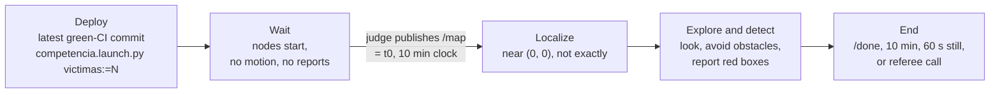
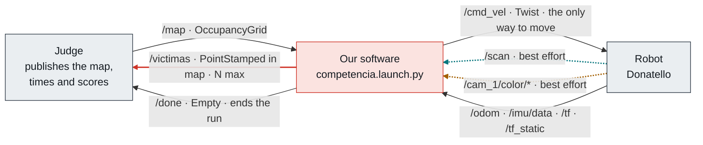
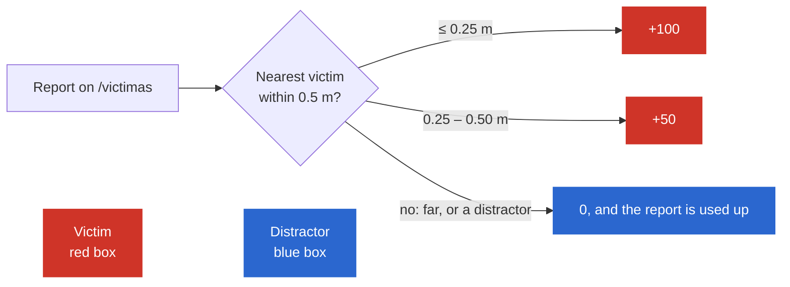
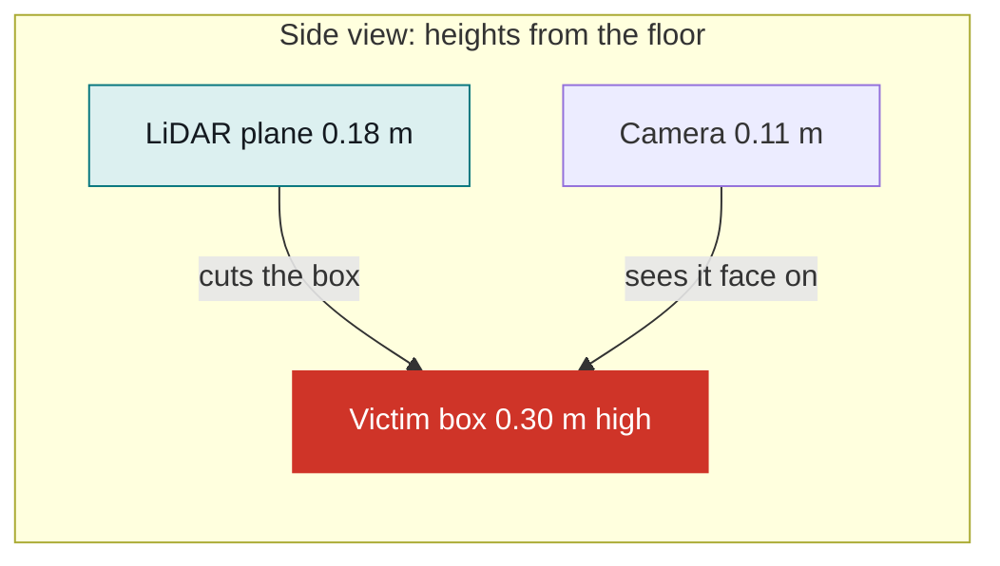
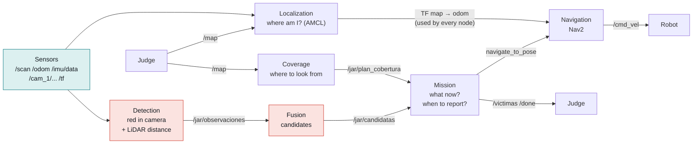
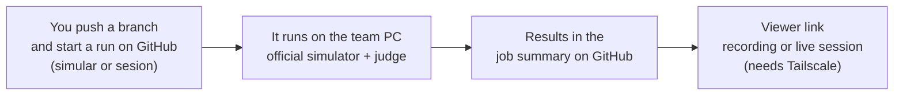

# Project overview

The whole project in about 10 minutes, for teammates new to ROS 2. Exact numbers and rules
are in the root [`CLAUDE.md`](../../CLAUDE.md); module contracts in
[`INTERFACES.md`](INTERFACES.md); branches and PRs in [`FLOW.md`](FLOW.md). If anything here
contradicts the official rules, the rules win:
https://airclub-udesa.github.io/jar_site/reglamento/ .

## The mission in a paragraph

The judges place **Donatello**, a Yahboom ROSMASTER X3, by hand near the origin of a maze we
have never seen. When the judge publishes the maze map on `/map`, a 10-minute clock starts.
From then on the robot is on its own: it must work out where it is on that map, drive
through the maze without hitting anything, find the victims (red boxes) with the camera and
the LiDAR, and publish each one's position on `/victimas`. If it then returns to the start
and publishes `/done`, it earns a bonus.

No remote control, no second try: if our program crashes, the run goes on with the robot
standing still.

> [!IMPORTANT]
> **Key idea: the software must generalize.** The competition map, victims and obstacles are
> new, and hard-coding coordinates, routes or arena geometry is forbidden (CI checks it).
> Everything the robot knows about the place must come from `/map` and its sensors during
> the run.

## A run, step by step

1. **Deploy.** The organizers take our fork's latest commit with green CI and run
   `ros2 launch equipo_jar competencia.launch.py victimas:=N` (N = number of victims; in the
   simulator also `use_sim_time:=true`).
2. **Wait.** Our nodes start, subscribe to the sensors and wait. Before `/map`: no non-zero
   `/cmd_vel`, no reports, and the launch stays alive.
3. **Start.** The judge publishes `/map`. That message is the start signal and t0 of the clock.
4. **Localize.** The robot starts near (0, 0) with unknown error and heading. It estimates
   its pose by matching the LiDAR against the map.
5. **Explore and detect.** It picks places to look from, avoids walls and obstacles that are
   not in the map, and reports each box it is sure about.
6. **End,** at the first of: we publish `/done`, 10 minutes pass, the robot stays 60 s
   without moving, or the referee stops it (tip-over, leaving the maze).

> [!WARNING]
> **The 60-second rule.** A robot that stands still "thinking" for a minute ends its run,
> even with time left. Any long wait (e.g. while localization converges) needs some motion,
> even turning slowly in place. The practice judge counts anything below 0.02 m/s and
> 0.05 rad/s on `/odom` as still.

## What the robot receives and publishes

Our software talks to the world only through ROS 2 **topics**: named channels that carry
messages of one fixed type. This interface is official and can't be changed or extended.

| Topic | Direction | Type | What it carries |
| --- | --- | --- | --- |
| `/map` | judge → us | `nav_msgs/OccupancyGrid` | The maze as a grid of free, occupied and unknown cells |
| `/victimas` | us → judge | `geometry_msgs/PointStamped` | One report: (x, y) of a victim in the `map` frame |
| `/done` | us → judge | `std_msgs/Empty` | "Finished": ends the run |
| `/cmd_vel` | us → robot | `geometry_msgs/Twist` | Wanted velocities: forward, sideways, turn |
| `/scan` | robot → us | `sensor_msgs/LaserScan` | LiDAR distances, 360° |
| `/odom` | robot → us | `nav_msgs/Odometry` | How far the robot thinks it moved, from its wheels |
| `/imu/data` | robot → us | `sensor_msgs/Imu` | Accelerations and turn rate |
| `/cam_1/color/image_raw` | robot → us | `sensor_msgs/Image` | The front camera image |
| `/cam_1/color/camera_info` | robot → us | `sensor_msgs/CameraInfo` | Camera parameters (pixels → angles) |
| `/cam_1/depth/color/points` | robot → us | `sensor_msgs/PointCloud2` | 3D point cloud (unreliable: gaps, short range) |
| `/tf`, `/tf_static` | robot → us | `tf2_msgs/TFMessage` | Where each part of the robot is relative to the others |

Two traps show up from day one:

- **Best effort sensors.** `/scan` and the camera topics are sent *best effort* (dashed
  above). A node that subscribes with the default settings gets nothing, and no error.
  Subscribe with `qos_profile_sensor_data` (see [`docs/QOS.md`](../QOS.md)).
- **One `/cmd_vel` publisher.** It is the only way to move the robot, so exactly one of our
  nodes (navigation) publishes it.

Our own topics between modules use the `/jar/` prefix ([`INTERFACES.md`](INTERFACES.md)).

## How you win

| Event | Points |
| --- | --- |
| Report ≤ 0.25 m from a victim's center | +100 |
| Report 0.25–0.50 m from it | +50 |
| Report farther away | 0 (and it uses up a report) |
| Fast bonus: all N victims scored with reports sent before 5 min | +200 |
| `/done` within 0.25 m of the start, with at least one victim scored | +100 |
| Each collision (wall, obstacle or any box) | −50 |
| Leaving the maze (also ends the run) | −50 |
| Tipping over more than 45° | the run scores 0 |

Three consequences to keep in mind from day one:

- **There are exactly N reports.** One on a distractor, a malformed one (`frame_id` not
  `map`, a NaN) or a far one is lost. "Seeing red" is not enough: report only boxes you are
  sure about. Build every report with `armar_reporte()` (`src/equipo_jar/equipo_jar/reportes.py`).
- **Precision is worth as much as finding.** 100 vs 50 points is 25 cm. That error is split
  between the robot's localization and the box-center estimate, so both must be good. The
  official position is the box's center on the floor, not the face we see, which is
  0.125 m closer: half of the 100-point margin.
- **Collisions are expensive.** One costs half a well-reported victim. Careful driving wins.

Ties go to the shorter run, so publishing `/done` as soon as we finish (ideally at the start)
also counts.

> [!TIP]
> **Try it.** Score this run with N = 3: one victim at 0.18 m, one at 0.41 m, one report on a
> distractor, one collision, and `/done` 0.20 m from the start at minute 7.
> 

Answer
100 + 50 + 0 − 50 + 100 = 200. No fast bonus: not all 3
> victims were scored.

## Meet Donatello

In the official simulator the robot is called Donatello. It models the physical ROSMASTER X3:
the same sensors and mounts, the same topics and the same speed limits.

| Part | Data | Why it matters |
| --- | --- | --- |
| Chassis | 0.30 × 0.20 m | How much to "inflate" the walls when planning |
| Wheels | 4 mecanum, 32.5 mm radius | It can move sideways without turning |
| LiDAR | 360°, 1080 rays, ~7 Hz, 0.05–12 m, 0.18 m above the floor, **mounted turned 180°** | Ray 0 points backwards: always use TF |
| Camera | 320 × 240 px at 30 Hz, ~61° wide, 0.11 m above the floor | Finds red; sees only what is in front |
| IMU | 10 Hz | Measures turns; helps odometry |
| Odometry | `/odom` at 10 Hz, from `odom` to `base_footprint` | Movement estimated from the wheels; drifts |
| Command limits | 1.0 m/s in x and y, 5 rad/s turning | Anything above is clipped |

Victims are 0.25 × 0.25 × 0.30 m boxes. The LiDAR plane (0.18 m) cuts them and the camera
(0.11 m) sees them, so both sensors can find them. In the practice maps the distractors are
blue boxes; in the competition they may be other colors, never red, and there may be
obstacles that are not in `/map`.

## The software pieces

An autonomous robot is not one big program but several small ones (ROS 2 **nodes**) that
pass information to each other. Ours has six modules:

- **Localization**: "where am I on the map?" Matches odometry and the LiDAR against `/map`
  and publishes the TF `map → odom`, so every node can place things in `map`.
- **Navigation** (Nav2): "how do I get there without hitting anything?" The only publisher
  of `/cmd_vel`.
- **Coverage**: "where do I look from?" Viewpoints with an orientation (the camera sees only
  61°), in visiting order.
- **Detection** and **Fusion** (perception): "is that a victim, and where is its center?"
  Detection turns what the camera and LiDAR see into points in `map`; fusion groups them
  into candidates with an uncertainty.
- **Mission**: "what do I do now?" Sends navigation its goals, decides when to report each
  candidate, and when to return and publish `/done`. The only one that reports.

Integration: one launch, `competencia.launch.py`, starts everything: one node per module,
plus `navegacion.launch.py` for localization (AMCL) and Nav2. Tunable values live in
`src/equipo_jar/params/` (only that folder may change after the delivery cutoff).
`src/equipo_jar_msgs` holds our own message types. Who owns each module: root `CLAUDE.md`,
"Team". What each one passes to the others: [`INTERFACES.md`](INTERFACES.md).

> [!NOTE]
> **In JAR.** `pruebas.launch.py` is `competencia.launch.py` plus a fixed `map → odom`, so
> every module can be tested in the simulator without AMCL. It never goes
> into the competition launch.

## Where each thing runs

| Place | What runs | Good for |
| --- | --- | --- |
| Ubuntu 22.04 + ROS 2 Humble + Gazebo Fortress (native or Docker on Linux) | Everything: the official simulator with camera, the practice judge, `tools/` | The reference platform |
| macOS (Apple Silicon), Gazebo Classic via pixi | One obstacle world, no practice mazes, no camera, no IMU; walls don't stop the robot | LiDAR and navigation prototypes only |
| **The team's simulation server**, from GitHub | The official simulator and judge, on any of the practice maps | Testing a branch from any laptop (Mac or Windows) |
| The competition | A track station networked to the real robot runs our latest green-CI commit; our Docker image must build and run without internet | The real thing |

The simulation server, from your side:

- **Batch runs** (`simular`): a branch on some maps for a fixed time → score, end reason,
  optional recording.
- **Live sessions** (`sesion`): drive a branch by hand in the browser.

How to use it: [`SIMULATION.md`](SIMULATION.md). It doesn't replace CI.

## Rules that shape the design

These are not paperwork: they change how the code is written.

- **One launch:** `ros2 launch equipo_jar competencia.launch.py` starts everything and waits
  for `/map`.
- **N as an argument:** the number of victims comes only as `victimas:=N` (the `mision` node
  gets it as `cantidad_victimas`), never from a params file.
- **Config in `src/equipo_jar/params/`:** speeds, margins, thresholds live in YAML, not in
  code. After the delivery cutoff only that folder may change, so every tunable must be a
  named parameter.
- **Nothing hard-coded:** CI checks for fixed arena geometry. No coordinate lists, no map
  files, no practice-world names in `src/`.
- **Real clock in the competition:** the real robot doesn't publish `/clock`; the simulator
  does, and `use_sim_time` handles it.
- **No restarts:** an uncaught exception kills a node and it is not brought back. Callbacks
  must be robust.
- **No internet:** our Docker image runs with `--network none`. Every dependency goes into it
  at build time (`package.xml`, `requirements.txt`).
- **While moving, publish `/cmd_vel` at ≥ 10 Hz** (the robot stops after 0.5 s of silence).
  After `/done`, never move again.

The full list of CI traps: root `CLAUDE.md`, "CI and delivery traps".

## Summary

- The robot waits for `/map`, localizes near the origin, explores, finds red boxes, sends at
  most N reports on `/victimas` and, if it can, returns and publishes `/done`.
- Everything goes through the official topics. Two early traps: best effort sensors and the
  single `/cmd_vel` publisher.
- Donatello is 0.30 × 0.20 m, moves in any direction (mecanum wheels), and sees with a
  360° LiDAR mounted backwards and a 61° camera.
- Report accuracy depends on localization and on estimating the box's center, not its face.
